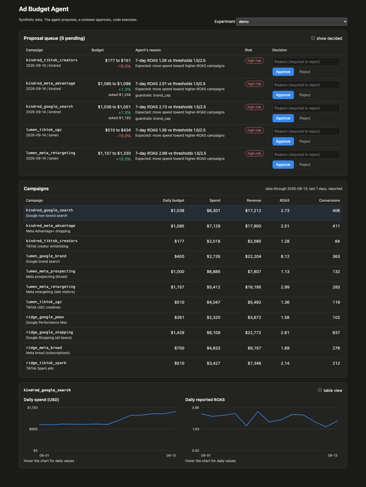

# Ad Budget Agent

A Claude agent that proposes daily budget moves for the ad campaigns of direct-to-consumer brands. It reads event-level performance data from **ClickHouse** through tool calls that run fixed, parameterized queries, returns a strict JSON proposal with a reason and an expected effect for each move, and never executes anything itself: guardrails in code clip or block moves, proposals queue in **Postgres** for approval (suggest / approve / automate modes), and approved moves execute in the same transaction as the approval. Reviewer decisions, with their reasons, are stored as memory and fed into the next day's proposal. An eval runs the agent over simulated weeks against two baselines and scores it on hidden ground truth.

Built with Python, the Anthropic Python SDK (tool use + structured outputs), ClickHouse, Postgres, FastAPI, React (Vite, TypeScript), Docker Compose and pytest.

**All data is synthetic.** The brands ("Lumen Skincare", "Ridgeline Coffee", "Kindred Pet Supply"), campaigns, spend and sales are generated by a simulator in this repo. Nothing comes from a real ad account, and the project is not affiliated with any company.

## Why

Budget agents for paid media work in a loop: read performance, propose moves, a person approves, the system executes. The hard parts are not the model call. They are keeping the model away from anything it should not touch, making the limits hold no matter what the model says, choosing the right store for each kind of data, remembering what a reviewer already said no to, and measuring whether any of it beats a simple rule. This project builds each of those pieces small enough to read in an afternoon.

## Architecture

```
                         +--------------------------------------------+
   sim/market.py         |  hidden ground truth (response curves,     |
   (synthetic market) -> |  attribution gap, fatigue, broken pixel)   | --> eval scorer only
         |               +--------------------------------------------+
         | hourly ad stats + one row per reported conversion
         v
+---------------------------+         parameterized queries        +---------------------+
| ClickHouse (OLAP)         | <----------------------------------- | agent/tools.py      |
|  ad_stats_hourly          |   get_campaign_metrics(window_days)  |  2 strict tools,    |
|  conversion_events        |   get_daily_trend(campaign_id, days) |  brand bound in code|
|  campaign_daily  <- 2 MVs |                                      +---------------------+
+---------------------------+                                                ^
                                                                             | tool_use / tool_result
                                 +------------------------------+            |
   day message + reviewer memory | agent/loop.py                | <--------> Claude (claude-haiku-5-5)
  -----------------------------> | tool loop, JSON validation,  |            structured output (JSON)
                                 | 1 retry, fallback = hold     |
                                 +------------------------------+
                                               | requested budgets
                                               v
                                 +------------------------------+
                                 | agent/guardrails.py (code)   |  tracking freeze, +/-20% per day,
                                 |                              |  learning floor, brand cap
                                 +------------------------------+
                                               | final budgets + interventions
                                               v
+---------------------------+    +------------------------------+     +----------------------+
| Postgres (OLTP)           | <- | engine/cycle.py              | <-> | reviewer             |
|  campaigns (budgets)      |    | proposals -> approval mode:  |     |  simulated (evals) or|
|  agent_runs, proposals    |    | suggest | approve | automate |     |  a person (dashboard)|
|  approvals, budget_changes|    +------------------------------+     +----------------------+
|  guardrail_events         |
|  decision_memory  --------+--> recalled into the next day's prompt
|  decision_log (audit)     |
+---------------------------+
         ^
         |  FastAPI (api/main.py)  <-->  React dashboard (web/): proposal queue, metrics, charts
```

Each simulated morning, for each brand: Claude reads metrics through the tools, proposes moves as JSON, code validates and enforces the limits, the proposal rows go to Postgres, and the approval mode decides what happens next. Then the market simulates the day with the budgets that were actually executed, and the new events land in ClickHouse.

### OLAP vs OLTP: why two databases

| | ClickHouse (events) | Postgres (agent state) |
|---|---|---|
| Data | hourly ad stats, one row per conversion | budgets, proposals, approvals, memory, audit log |
| Shape | append-only, grows every hour, read as aggregates over time ranges | small, updated in place, read and written row by row |
| Typical query | "sum spend and revenue per campaign for the last 7 days" | "lock this proposal and the brand's budgets, check the cap, update, record the approval" |
| Why this store | columnar, compressed, sorted parts: scans only the columns a query needs and skips granules outside the key range | transactions, row locks, constraints, foreign keys |
| What it would be bad at | transactional updates (no multi-statement transactions; deletes are heavy mutations) | scanning large event history for aggregates |

Specific choices in `storage/clickhouse/schema.sql`: MergeTree tables sorted by `(experiment_id, brand_id, campaign_id, ts)` because every query filters on experiment and brand (often campaign) plus a time range; monthly partitions; `LowCardinality(String)` ids; `Decimal(18, 4)` money; and a `campaign_daily` SummingMergeTree filled by two materialized views (one per raw table). Because SummingMergeTree only collapses rows when parts merge, every read still uses `GROUP BY` and `sum()` (`storage/queries.py`). An integration test checks the rollup against the raw event tables.

Postgres (`storage/postgres/migrations/001_init.sql`) has CHECK constraints on every status column, foreign keys with cascade, and an `experiment_id` on every table so eval runs never collide. `StateStore.decide` is one transaction: lock the proposal and the brand's campaign rows (`FOR UPDATE`), refuse a stale proposal (the budget changed since it was proposed) or one that would break the brand cap, update the budget, and write the approval, memory and audit rows.

## What the model decides vs what code decides

| Decided by code | Decided by the model |
|---|---|
| Which queries exist and which brand a run can read | Which metrics and windows to look at |
| Whether the proposal is valid (schema, campaign ids, action matches budget) | Which campaigns to move, by how much, and why |
| The final budget after guardrails | What effect it expects |
| Whether a move is low risk (auto-approve policy) | Which campaigns to flag for a human |
| What executes, and when (approval + transaction) | |
| What happens when the model fails (hold every budget) | |

## Guardrails

All in code (`agent/guardrails.py`, `agent/proposal.py`, `agent/loop.py`), all tested, and the same budget guardrails apply to every policy, including the baselines.

1. **Strict output, one retry.** The final answer is constrained with structured outputs (`output_config.format`) and still validated with Pydantic (`extra="forbid"`) plus semantic checks: every campaign id belongs to the brand, no duplicates, and `increase` / `decrease` / `hold` matches the budget it names. A failure is sent back to the model once with the exact error.
2. **Deterministic fallback.** Invalid output twice, the tool budget spent, exhausted API retries, a refusal or any other model error: hold every budget and record the run as a fallback with its reason.
3. **Tracking freeze.** A campaign with at least 300 clicks and zero reported conversions over the last 3 days keeps its budget, in both directions. Reported ROAS 0 is exactly what would make an optimizer cut a campaign that may be working (in the simulator, it is: its true sales continue).
4. **Max daily change.** Clipped to +/-20% of the current budget.
5. **Minimum learning budget.** No campaign below the brand's floor ($60/day here).
6. **Brand cap.** If the total is over the brand's daily cap, increases are scaled down pro rata. The cap is checked again at execution, under a row lock.
7. **Read-only, scoped tools.** Two tools with `strict: true` input schemas. Window lengths come from a fixed enum, the campaign id is checked against the brand in context, the brand itself is never a tool argument, and values are bound as ClickHouse server-side parameters. The model never writes SQL.
8. **Tool budget.** At most 10 tool calls per run. A batch that would go over is not run; the model is told the budget is used up and can answer once with the data it has. Asking for more tools after that ends in the fallback.

## Approval modes and memory

- `suggest`: proposals are written; nothing executes (shadow mode).
- `approve` (default): every move waits for a reviewer.
- `automate`: a move executes immediately if it is low risk (`approvals/policy.py`: executed change within +/-10%, no guardrail touched it, and not an increase on a campaign the agent flagged); everything else waits for a reviewer.

In evals the reviewer is `approvals/reviewer.py`, a simulated media buyer who knows things the agent is never told: never cut the strategic prospecting campaign (in the simulator it reports only 45% of its real sales), never scale brand search (it is saturated), and never scale a campaign below the brand's target ROAS. In the dashboard the reviewer is a person, and their decision goes through the same `decide` path.

Every reviewer decision is stored in `decision_memory` with the reason. Before each run, `recall` takes the latest decision per (campaign, direction, decision) for the brand, rejections first, newest first, at most 8, only from earlier days (one `DISTINCT ON` query), and the prompt includes them in a `<reviewer_memory>` block. This is structured retrieval in SQL rather than embeddings: "relevant" is exactly definable here, so a vector index would add fuzziness without adding recall.

## Evals

`python -m evals.run` simulates a 7-day warm-up at the initial budgets, then N eval days. Every morning each policy sets the day's budgets for each of the 3 brands, the market simulates the day, and the events land in the event store. Policies:

- `hold`: never changes a budget.
- `roas_rule`: +20% if 7-day reported ROAS >= 2.5, -20% if under 1.5.
- `agent`: Claude proposes, the simulated reviewer approves or rejects, memory on.
- `agent_no_memory`: the same without the `<reviewer_memory>` block.

Baselines execute their moves directly (no reviewer). Every policy goes through the same guardrails. The scorer reads hidden ground truth (`evals/metrics.py`): the headline is **expected true revenue**, the noise-free value of each campaign's true response curve at the spend the policy chose, which includes the sales the platforms did not report. "Net after ad spend" is expected true revenue minus spend. A **repeated rejection** is a rejection for the same campaign, direction and reviewer rule as an earlier rejection. One RNG per (seed, campaign, day) means two policies that choose the same budget get the same outcome, so differences come from decisions, not luck.

### Offline (scripted, no model)

`uv run python -m evals.run` uses `RulePlayingModel`, a fixed rule played through the real tool loop. It tests the pipeline (tools, queries, validation, guardrails, approvals, memory), not Claude. `evals/reports/example-scripted-offline.md` is a committed example from 2026-10-29. On 2026-10-29 the two baselines run on ClickHouse and Postgres (`--store db`) produced exactly the numbers of the in-memory run, and `tests/test_db_integration.py` asserts the same for a short scripted-agent experiment.

### Real model (2026-10-29, `claude-haiku-5-5`, effort `medium`)

Runs used ClickHouse 24.8.14 and Postgres 17.11 in Docker Compose. Each agent experiment was launched for 21 eval days, two seeds (7 and 11), all 3 brands.

**What happened during the runs.** The API account's credit ran out partway through: from simulated day 2026-09-17 (2026-09-16 for one experiment) every call returned HTTP 400 "credit balance is too low", and every run from then on fell back to holding budgets, as the fallback is designed to do. The model is not at fault for those days, so the 21-day totals are not a fair score. Each simulated day depends only on earlier days, so the first 8 eval days (2026-09-08 to 2026-09-15), where every model call succeeded in every experiment, are a valid 8-day experiment on their own. `evals/rescore.py` rebuilds them from Postgres (budgets from `budget_changes`, ground truth by re-running the deterministic market); re-scoring a complete 21-day experiment with it reproduced its original report exactly. The numbers below are that 8-day window. Total model spend for all real runs on 2026-10-29, including an aborted first attempt and a one-brand probe, was $0.44 at list price (546 model calls), well under the $4 budget.

Seed 7 (`evals/reports/results-2026-10-29-seed7-8days.md`):

| policy | spend | expected true revenue | true ROAS | net after ad spend | net vs hold | proposals | rejected | repeated rejections |
|---|---|---|---|---|---|---|---|---|
| hold | 54,939 | 152,533 | 2.776 | 97,594 | | 0 | 0 | 0 |
| roas_rule | 63,643 | 159,357 | 2.504 | 95,714 | -1.9% | 58 | 0 | 0 |
| agent (approve, memory) | 55,541 | 158,012 | 2.845 | 102,471 | +5.0% | 39 | 3 | 0 |
| agent (approve, no memory) | 58,061 | 163,323 | 2.813 | 105,262 | +7.9% | 58 | 19 | 15 |
| agent (automate, memory) | 57,670 | 161,759 | 2.805 | 104,089 | +6.7% | 34 | 3 | 0 |

Seed 11 (`evals/reports/results-2026-10-29-seed11-8days.md`):

| policy | spend | expected true revenue | true ROAS | net after ad spend | net vs hold | proposals | rejected | repeated rejections |
|---|---|---|---|---|---|---|---|---|
| hold | 54,849 | 152,284 | 2.776 | 97,435 | | 0 | 0 | 0 |
| roas_rule | 63,837 | 160,558 | 2.515 | 96,720 | -0.7% | 54 | 0 | 0 |
| agent (approve, memory) | 56,736 | 160,556 | 2.830 | 103,820 | +6.6% | 32 | 3 | 0 |
| agent (approve, no memory) | 58,230 | 163,284 | 2.804 | 105,054 | +7.8% | 55 | 18 | 13 |

Cost and latency per 8-day, 3-brand agent experiment (24 runs): $0.057 to $0.060, about 70 to 74 model calls and about 290,000 input / 60,000 output tokens; per-run latency p50 13.0 to 15.1 s, p95 16.5 to 19.9 s. Zero fallbacks and zero guardrail interventions in the window; 0 to 2 output retries per experiment, all recovered on the retry.

What the numbers say, and do not say:

- **Every agent variant beat both baselines on net after ad spend in both seeds** (+5.0% to +7.9% over holding), with a higher true ROAS than either baseline. The ROAS rule spent the most and earned the least net: in seed 7 it cut the strategic prospecting campaign from $1,000 to $168 a day (its reported ROAS is about 1.1, its true ROAS about 2.5) and scaled saturated brand search from $400 to $1,300. The agent proposed similar moves on those two campaigns, the reviewer rejected them, and they never executed. On its own it cut the fatiguing TikTok creative ($600 to $384) and the weak Performance Max campaign ($500 to $166), and scaled Google Shopping ($800 to $1,595).
- **Memory removed repeated rejections: 15 and 13 without memory, 0 and 0 with it** (total rejections 19 and 18 without, 3 and 3 with). With memory, each reviewer rule was hit once and not again.
- **Memory did not improve revenue.** The no-memory agent had higher net in both seeds (by 2.7% and 1.2%). In approve mode a rejected move never executes, so memory mainly saves reviewer effort; the agent with memory also proposed fewer moves overall (39 vs 58, 32 vs 55) and spent less, which cost some upside. Two seeds over 8 days cannot separate that from noise in the model's choices.
- **Not tested by the real runs:** the broken-tracking campaign only becomes detectable (3 days of clicks with zero conversions) on 2026-09-16, after the clean window, and the promo week starts on 2026-09-18. Both are covered by unit tests, and in the full 21-day baseline runs (no model involved) the tracking freeze blocked the ROAS rule's cuts to that campaign 13 times in each seed.

**Finding from the first real attempt (2026-10-29, aborted).** The first launch used a 6-call tool limit. Claude sometimes asked for the daily trend of several campaigns in one parallel batch and overshot it, so 3 of the first runs fell back to holding. The limit was too tight and too abrupt, not a model error. It is now 10, and going over is graceful: the batch is not run, the model is told its tool budget is used up, and it answers with the data it has (`agent/loop.py`, tests in `tests/test_agent_loop.py`). Those runs were discarded and all experiments above were run with the new limit.

## Running it

Requirements: Python 3.13 or newer, [uv](https://docs.astral.sh/uv/), Docker (for ClickHouse and Postgres), Node 20+ (only for the dashboard).

```bash
uv sync
uv run pytest                     # unit tests: offline, no API key, no Docker
uv run ruff check .
uv run python -m evals.run        # offline eval: scripted policy, in-memory stores
```

With the databases:

```bash
docker compose up -d --wait       # ClickHouse 24.8 on :18123, Postgres 17 on :55432
uv run pytest -m db               # integration tests against both
uv run python -m evals.run --store db
```

With the real model: copy `.env.example` to `.env`, set `ANTHROPIC_API_KEY`, then

```bash
uv run --env-file .env python -m evals.run --model anthropic --store db \
    --policies agent,agent_no_memory --days 21 --budget-usd 4
```

`--budget-usd` is a hard stop: the eval refuses to start a model call once tracked spend reaches it. `AGENT_MODEL` (default `claude-haiku-5-5`) and `AGENT_EFFORT` (default `medium`) select the model and effort. Prices used for cost reporting are in `settings.py`.

Dashboard (approval queue with approve/reject and a reason, campaign table, daily spend and ROAS charts):

```bash
uv run python -m scripts.seed_demo          # demo experiment with pending proposals (scripted)
uv run uvicorn api.main:app --port 8000
cd web && npm install && npm run dev         # http://localhost:5173
```



The screenshot (2026-10-29) shows the `demo` experiment seeded by the scripted policy, so the reasons are the rule's, not Claude's.

## Tests

`uv run pytest` runs 89 offline tests; `uv run pytest -m db` runs 5 integration tests against the Docker Compose ClickHouse and Postgres. On 2026-10-29 both passed, and ruff passed.

| File | Tests | Covers |
|---|---|---|
| `test_market.py` | 8 | determinism, common random numbers, diminishing returns, tracking break, attribution gap, fatigue and season, event consistency |
| `test_events.py` | 3 | window bounds, ratios from sums, in-memory event store |
| `test_proposal.py` | 15 | schema and semantic validation |
| `test_guardrails.py` | 10 | each guardrail, ordering, pro-rata cap scaling, tracking detection |
| `test_tools.py` | 4 | strict schemas, brand scoping, tool errors |
| `test_agent_loop.py` | 12 | tool loop, retry, fallbacks, graceful tool budget, memory in prompt |
| `test_anthropic_model.py` | 8 | request shape, response mapping, error classification (stub client) |
| `test_state.py` | 7 | decide/execute, stale and cap checks, memory recall |
| `test_reviewer.py` | 2 | reviewer rules, risk classification |
| `test_cycle.py` | 10 | approval modes, guardrail recording, execution order, fallback, baselines, audit log |
| `test_evals.py` | 7 | scoring, memory effect on the scripted policy, CLI, spend guard |
| `test_api.py` | 3 | API reads, approve/reject, validation |
| `test_db_integration.py` | 5 | ClickHouse vs in-memory numbers, rollup vs raw tables, Postgres transaction and recall, a full short experiment scoring identically on both store pairs, the re-scorer reproducing a stored experiment |

## Layout

```
sim/            scenario (brands, campaigns, hidden parameters) and the market simulator
storage/        ClickHouse schema + queries + event store; Postgres migrations + state store
agent/          tools, prompts, proposal schema, guardrails, loop, Anthropic + scripted models
approvals/      approval modes, risk policy, simulated reviewer
engine/         policies (agent, baselines), one brand-day cycle, full simulation
evals/          scoring, CLI, report combiner, re-scorer, reports/
api/            FastAPI approval-queue API
web/            React + Vite + TypeScript dashboard
scripts/        seed_demo.py
tests/          pytest suite (offline) and -m db integration tests
```

## Limitations

- **The simulator is mine.** The agent is tested on traps I designed (an attribution gap, a saturated campaign, a fatiguing creative, a broken pixel, a promo week). The results show the loop works and is measured correctly; they do not show the agent would beat a person on a real account.
- **Small sample.** Two seeds, 8 clean eval days of real-model runs (the API credit ran out after that), 3 brands, 11 campaigns.
- **The reviewer is a rule set.** Real reviewers are inconsistent, and their reasons are free text that would need better retrieval than a recency-ordered SQL query.
- **No real ad-platform behavior.** No auction dynamics, learning-phase resets, attribution windows or conversion lag; spend is assumed to track budget.
- **One run at a time per brand.** A production system would queue runs per brand on workers, with per-tenant spend limits.
- **ClickHouse resets use mutations** (`ALTER TABLE ... DELETE`), fine for evals; production retention would use TTLs or partition drops.

## How this was built

Built by Mayank Bhadrasen with Claude Code.

## License

MIT, see [LICENSE](LICENSE).
